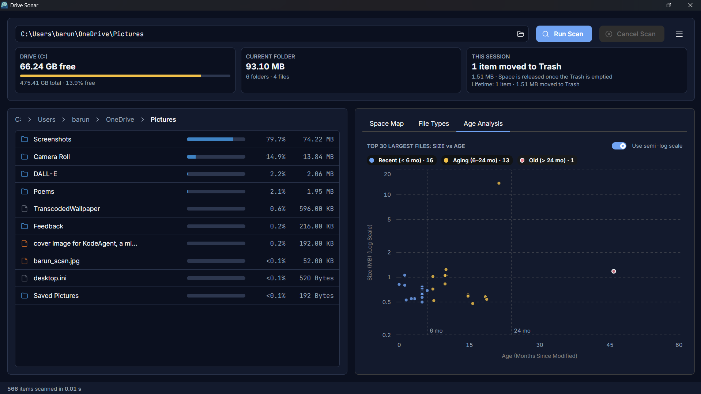

# Drive Sonar

<p align="center">
  
</p>

[Drive Sonar](https://drivesonar.download/) is a fast, lightweight desktop disk usage explorer and analyzer built with Tauri v2, Rust, React, and TypeScript.

Drive Sonar is inspired by the simplicity of `ncdu`. Drive Sonar offers different visualizations to help you gain a better idea of your disk usage.

[Drive Sonar](https://drivesonar.download/) runs entirely in **user mode**—no admin mode or elevated privilege is required to scan even the most protected corners of your disk. It's also fully **open source**, so you can see exactly what it's doing and build it yourself if you'd rather not trust a binary.

## ⚡ Features

- **Fast Parallel Scanning:** Native fast-path scanning on Windows and a multi-threaded fallback for other platforms
- **Interactive Visualizations:**
  - **Space Distribution Map:** High-performance storage treemap
  - **Extension Breakdown:** Top file extensions by storage utilization
  - **File Age Analysis:** Scatter plot visualizing file size vs. age
- **In-App File Management:** Open files or folders directly in native OS file managers or safely move items to system trash (requires confirmation + additional background safety checks)
- **Local-Only Stats:** A lifetime total of what you moved to the Trash is kept in the app's local storage on your device, with no network use and no telemetry; reset it anytime from the About dialog
- **Print Scan Report:** Not just identify what's causing high disk usage, but also export a report for the future reference
- **Security Hardened:** Path canonicalization guards against relative traversal, strict Content Security Policy (CSP), and system root deletion protection
- **No Admin Required:** Runs entirely in user mode, unlike many disk analyzers that need elevated privileges to scan protected directories
- **Open Source:** Apache 2.0 licensed—inspect the code, fork it, or build it yourself

<p align="center">
  
</p>


## Disk Scanner Performance Comparison

| Metric | Drive Sonar | WinDirStat | WizTree |
|---|---:|---:|---:|
| Version tested | 0.10.0 | 2.8.0 | 4.3.1 |
| License | Apache 2.0 | GPL v2 | Proprietary |
| Runs in user mode (no admin required) | ✅ | ✅ | ❌[^1] |
| Installed size [MB] | **6.3** | 7.1 | 20.0 |
| Peak memory usage (median)[^2] [MB] | 305.6 | 286.8 | 560.1 |
| Warm scan time (median)[^3] [s] | **4.7** | 9.4 | 8.1 |
| Cold scan time (single run)[^4] [s] | **10.7** | 23.4 | 13.7 |

[^1]: **Admin requirement:** WizTree requires administrator privileges to read the NTFS Master File Table directly for its full-speed mode; without elevation it falls back to a slower standard directory scan. WinDirStat can be optionally run with admin privileges as well.

[^2]: **Memory usage:** Median of independent runs (peak memory), same scan location. For Drive Sonar, the overhead due to WebView2 is also included.

[^3]: **Warm scan:** Median of independent runs of the same folder, each app already opened once beforehand (warm file-system cache) — the scenario most users encounter when re-scanning (e.g., after deleting files). Because all three tools benefit equally from the OS file-system cache under this condition, disk I/O latency is minimized for each of them alike — this measurement isolates each application's own processing efficiency (directory traversal, tree construction, size aggregation) rather than raw disk speed.

[^4]: **Cold scan:** Median of 5 independent runs per app, each following a full system shutdown and reboot. Checked CPU and disk activitiy to reduce background OS contention. However, antivirus, One Drive, and other services ran in the background.


## 🤔 Why Drive Sonar?

Primarily, this started as a hands-on project to learn Rust and Tauri. But it's also grown into something I actually reach for: Windows' native storage view is fairly high-level, and I wanted something like `ncdu`, but with a GUI—fast and minimal, insightful without visual clutter, and one that doesn't demand admin rights just to tell me where my disk space went.

## 📥 Download

Pre-built binaries are available on the [Releases](https://github.com/barun-saha/drive-sonar/releases) page. Download the installer for your platform, run it, and you're good to go—no build step required.

> **Note:** The Windows installer isn't code-signed yet, so you'll likely see a Windows SmartScreen warning ("Windows protected your PC") on first run. This is just because the binary doesn't carry a paid publisher certificate—it's not a sign of malware. Click **More info → Run anyway** to proceed. Signing is on the radar for a future release.

## 🚀 Getting Started

On Windows, Drive Sonar requires Windows 10 version 1709 (October 2017 Update) or later. macOS and Linux have no additional version requirement.

### Prerequisites

- [Node.js](https://nodejs.org/) (v18+)
- [Rust](https://www.rust-lang.org/) (stable toolchain)

### Development

Install dependencies:

```bash
npm install
```

Run the application in development mode:

```bash
npm run tauri dev
```

### Production Build

Build the optimized desktop binary:

```bash
npm run tauri build
```

### 🧪 Unit Testing

#### Frontend (React / TypeScript)

First, ensure all project dependencies (including test libraries) are installed:

```bash
npm install
```

Run frontend unit tests with Vitest:

```bash
npm test
```

To generate frontend code coverage reports:

```bash
npm run test:coverage
```

#### Backend (Rust)

Run backend Rust unit tests:

```bash
cargo test --manifest-path src-tauri/Cargo.toml
```

To generate code coverage reports, install `cargo-tarpaulin` (if not already installed) and run:

```bash
cargo tarpaulin --manifest-path src-tauri/Cargo.toml --ignore-tests
```

## 📦 Release Process

To create a new release:

1. **Bump Version:** Set the same version number (e.g., `0.4.0` -> `0.5.0`) in:
   - [`package.json`](package.json) (`"version"`)
   - [`src-tauri/tauri.conf.json`](src-tauri/tauri.conf.json) (`"version"`)
   - [`src-tauri/Cargo.toml`](src-tauri/Cargo.toml) (`version` under `[package]`)
   Update `package-lock.json` with `npm install --package-lock-only` after changing `package.json`.
2. **Merge to `main`:** Commit changes, raise a PR, and merge into `main`. Release Drafter uses the version in `src-tauri/tauri.conf.json` for the draft's name, tag, and changelog link.
3. **Tag & Push:** Checkout the latest `main`, confirm the version files and draft agree, and push `v<version>` matching `src-tauri/tauri.conf.json`:
   ```bash
   git checkout main
   git pull origin main
   git tag v0.5.0
   git push origin v0.5.0
   ```
4. **Publish Release:** Pushing the `v*` tag triggers the GitHub Actions workflow, which checks that the tag matches the Tauri version before building binaries across platforms and attaching them to the same draft release. Review the notes and binaries, then publish the draft.


## Blogs and Videos

Find out more about Drive Sonar:

- [Drive Sonar](https://youtu.be/mGdI-Px6GYE?si=vk_akxUYh6HL5HtG)
- [Drive Sonar (legacy version)](https://www.youtube.com/watch?v=3nzoO78sRlY)
- [WinDirStat vs WizTree vs Drive Sonar: Which Free Disk Space Analyzer Should You Use in 2026?](https://dev.to/barun_saha/windirstat-vs-wiztree-vs-drive-sonar-which-free-disk-space-analyzer-should-you-use-in-2026-56lo)


## 📜 License

Drive Sonar is open-source software, released under the Apache 2.0 license.

---

[](https://hub.xerj.org/contributors/barun-saha)
